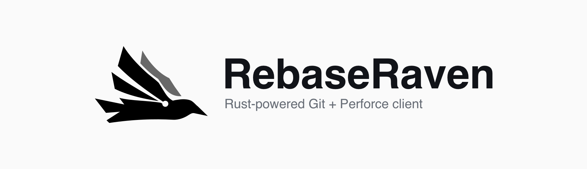

<p align="center">
  
</p>

<p align="center">
  <a href="https://github.com/FlyAndNotDown/RebaseRaven/releases/latest"></a>
  <a href="LICENSE"></a>
  <a href="https://github.com/FlyAndNotDown/RebaseRaven/actions/workflows/check.yml"></a>
</p>

<p align="center">
  <a href="https://rebaseraven.flyandnotdown.com/en/">Website &amp; interactive demo</a> ·
  <a href="https://github.com/FlyAndNotDown/RebaseRaven/releases/latest">Download</a> ·
  <a href="README.zh-CN.md">Simplified Chinese</a>
</p>

# A Rust-powered Git and Perforce client

**RebaseRaven** is a free, open-source **Git GUI and Perforce desktop client**,
built with **Rust and Tauri** for Windows and macOS. Review code and image diffs,
follow repository history, prepare Git commits or Perforce changelists, and
resolve conflicts in the app or your external merge tool.

| At a glance | RebaseRaven |
| --- | --- |
| Desktop foundation | Rust backend, Tauri application shell, React / TypeScript interface |
| Repository tools | Your installed Git and Perforce CLI (`p4`) |
| Release installers | Windows x64 · macOS Apple Silicon |
| Languages | English · Simplified Chinese |
| License | Free and open source · [MIT](LICENSE) |

## Git repositories. Perforce workspaces.

RebaseRaven works with your existing repositories, workspaces, and command-line
tools. Keep your Git configuration and your Perforce server, user, client, and
workspace view.

| Workflow | Git | Perforce |
| --- | --- | --- |
| Review changes | Text and image diffs; stage files, hunks, or selected lines | Working, shelved, and submitted diffs; code and image review |
| Follow history | Commit graph, file history, blame, and reflog | Changelists, file and folder history, line history, and specific revisions |
| Organize work | Branches, stashes, worktrees, submodules, and Git LFS workflows | Numbered changelists, team shelves, file moves, and file locks |
| Merge and resolve | Merge, cherry-pick, and interactive rebase; edit conflicts in the app | Preview integration and revision undo; resolve conflicts internally or externally |
| Publish changes | Commit, fetch, pull, and push | Sync, reconcile, shelve, restore shelves, and submit |

**Try it before installing:** the [interactive Git and Perforce demo](https://rebaseraven.flyandnotdown.com/en/#features)
uses sample data in your browser. It never changes a real repository.

## Get started

1. [Download RebaseRaven](https://github.com/FlyAndNotDown/RebaseRaven/releases/latest)
   for **Windows x64** or **macOS Apple Silicon**.
2. Install **Git** for Git repositories, or the **Perforce CLI (`p4`)** for
   Perforce workspaces. Git LFS repositories also require **Git LFS**.
   Select the executable in Settings if needed.
3. Open a local folder, clone or initialize a Git repository, or connect to a
   Perforce workspace.

Use repository tabs, the command palette, keyboard shortcuts, and light or dark
themes. The app follows your system language by default; English and Simplified
Chinese are available in Settings.

## Questions

### How does RebaseRaven use Rust?

Rust powers the desktop backend, with Tauri providing the application shell.
The interface uses React and TypeScript. Repository operations run through your
installed Git and `p4` executables.

### Is RebaseRaven free?

Yes. RebaseRaven is free and open source under the MIT License. Source code and
release installers are available on GitHub. Linux users can build from source
with the Tauri platform prerequisites.

### Where do repository data and diagnostics go?

Repository files and Perforce workspace files stay on your device. Remote
operations connect to the servers you configure. Diagnostics remain local and
are shared only when you choose to export and send them.

Usage analytics is enabled by default. Google Analytics receives a random
installation ID, coarse app usage and foreground time, and basic device
information. Repository content, paths, and credentials are excluded. Turn it
off in **Settings → Diagnostics → Share usage analytics**.

## Build from source

Install Node.js 22.13+ on the 22.x line, 24.x, or 26+, stable Rust, and the
[Tauri platform prerequisites](https://v2.tauri.app/start/prerequisites/).
Linux builds require the Linux platform dependencies.

```sh
npm ci
npm run dev
```

To produce an application bundle:

```sh
npm run build
```

See the [development guide](docs/development.md) for the project structure and
checks. Contributions follow [CONTRIBUTING.md](CONTRIBUTING.md).

## Feedback and security

Report reproducible problems or suggest improvements in
[Issues](https://github.com/FlyAndNotDown/RebaseRaven/issues). Review diagnostic
exports before sharing: they can contain local paths, commands, and repository
information. Remove credentials and other details you do not want to share.
For vulnerabilities, follow the [security policy](SECURITY.md).

## License

[MIT](LICENSE)
