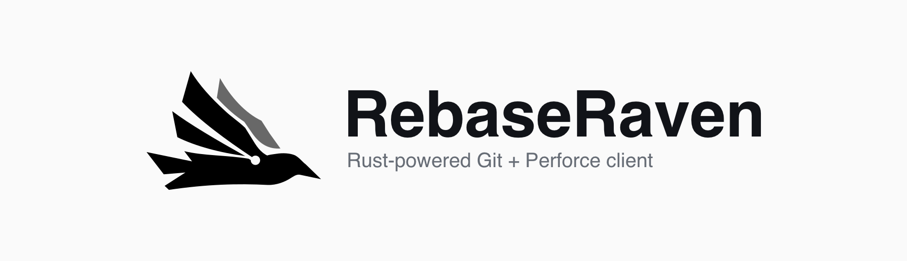

<p align="center">
  
</p>

<p align="center">
  <a href="https://github.com/FlyAndNotDown/RebaseRaven/releases/latest"></a>
  <a href="LICENSE"></a>
  <a href="https://github.com/FlyAndNotDown/RebaseRaven/actions/workflows/check.yml"></a>
</p>

<p align="center">
  <a href="https://rebaseraven.flyandnotdown.com/zh-CN/">官网与互动演示</a> ·
  <a href="https://github.com/FlyAndNotDown/RebaseRaven/releases/latest">下载</a> ·
  <a href="README.md">English</a>
</p>

# RebaseRaven — 基于 Rust 的 Git / Perforce 图形客户端

**RebaseRaven** 是基于 **Rust 与 Tauri** 构建的免费、开源 **Git / Perforce 桌面图形客户端**，
支持 Windows 与 macOS。审阅代码和图片差异、追溯仓库历史、准备 Git 提交或 Perforce Changelist，
并在应用内或外部合并工具中解决冲突。

| 产品信息 | RebaseRaven |
| --- | --- |
| 桌面基础 | Rust 后端、Tauri 应用外壳、React / TypeScript 界面 |
| 仓库工具 | 你安装的 Git 与 Perforce CLI（`p4`） |
| 安装包 | Windows x64 · macOS Apple Silicon |
| 界面语言 | 英语 · 简体中文 |
| 许可证 | 免费、开源 · [MIT](LICENSE) |

## Git 仓库，Perforce 工作区

直接使用现有仓库、工作区与命令行工具，沿用 Git 配置，以及 Perforce 的服务器、用户、Client 和工作区视图。

| 工作流 | Git | Perforce |
| --- | --- | --- |
| 审阅变更 | 文本与图片差异；按文件、差异块或选中的代码行暂存 | 工作区、Shelf、已提交版本的差异；代码与图片审阅 |
| 追溯历史 | 提交图、文件历史、Blame 与 Reflog | Changelist、文件与目录历史、逐行追溯，以及指定修订 |
| 整理工作 | 分支、Stash、工作树、子模块与 Git LFS 工作流 | 编号 Changelist、团队 Shelf、文件移动与文件锁 |
| 合并与解决冲突 | Merge、Cherry-pick、交互式 Rebase，以及应用内文本合并 | 预览集成与修订撤销，通过内部编辑器或外部工具解决冲突 |
| 提交与同步 | Commit、Fetch、Pull 与 Push | Sync、Reconcile、Shelve、恢复 Shelf 与 Submit |

**安装前先体验：** [Git 与 Perforce 互动演示](https://rebaseraven.flyandnotdown.com/zh-CN/#features)
使用浏览器中的示例数据，不会修改真实仓库。

## 开始使用

1. 下载适用于 **Windows x64** 或 **macOS Apple Silicon** 的
   [RebaseRaven 安装包](https://github.com/FlyAndNotDown/RebaseRaven/releases/latest)。
2. 为 Git 仓库安装 **Git**，为 Perforce 工作区安装 **Perforce CLI（`p4`）**。
   Git LFS 仓库还需要安装 **Git LFS**。如有需要，在设置中选择可执行文件。
3. 打开本地文件夹，克隆或初始化 Git 仓库，或者连接 Perforce 工作区。

通过仓库标签页、命令面板和快捷键接续工作，支持浅色与深色主题。
应用默认跟随系统语言，也可以在设置中选择英语或简体中文。

## 常见问题

### RebaseRaven 如何使用 Rust？

Rust 用于桌面后端，Tauri 提供应用外壳，界面由 React 与 TypeScript 构建。
Git 与 Perforce 的仓库操作通过你安装的 Git 和 `p4` 可执行文件执行。

### 支持 GitHub、GitLab 和自托管 Git 服务吗？

RebaseRaven 通过你安装的 Git 访问本地仓库，以及 HTTPS 或 SSH 远程仓库。
连接 GitHub、GitLab、Gitea 等 Git 服务时，沿用现有凭据与配置。
Pull Request 审阅等托管平台功能仍在对应 Git 服务中完成。

### 会转换或同步 Git 与 Perforce 仓库吗？

Git 仓库与 Perforce 工作区在 RebaseRaven 中是独立的工作流。
应用不转换仓库历史，也不在 Git 与 Perforce 之间同步变更。

### RebaseRaven 可以免费使用吗？

可以。RebaseRaven 免费使用，采用 MIT 开源许可证，源码与安装包均发布在 GitHub。
Linux 用户可以安装 Tauri 平台依赖后从源码构建。

### 仓库数据和诊断信息保存在哪里？

仓库文件与 Perforce 工作区文件保留在你的设备上，远程操作连接你配置的服务器。
诊断日志保存在本地，只有你主动导出并发送时才会分享给别人。

使用情况统计默认开启。Google Analytics 会接收随机安装标识、概括性的应用使用情况与前台使用时长，
以及基本设备信息，不包含仓库内容、路径或凭据。
你可以在 **设置 → 诊断 → 分享使用情况统计** 中关闭。

## 从源码构建

准备 Node.js 22.13+（22.x）、24.x 或 26+，稳定版 Rust，以及
[Tauri 平台依赖](https://v2.tauri.app/start/prerequisites/)。
在 Linux 上构建时，还需要安装对应的 Linux 平台依赖。

```sh
npm ci
npm run dev
```

构建应用安装包：

```sh
npm run build
```

项目结构与检查命令见[开发指南](docs/development.md)，参与贡献请阅读 [CONTRIBUTING.md](CONTRIBUTING.md)。

## 反馈与安全

欢迎在 [Issues](https://github.com/FlyAndNotDown/RebaseRaven/issues) 报告可复现的问题或提出建议。
分享诊断包前请先检查内容：日志可能包含本地路径、执行命令和仓库信息，请移除凭据以及不希望公开的内容。
报告漏洞请遵循[安全政策](SECURITY.md)。

## 许可证

[MIT](LICENSE)
